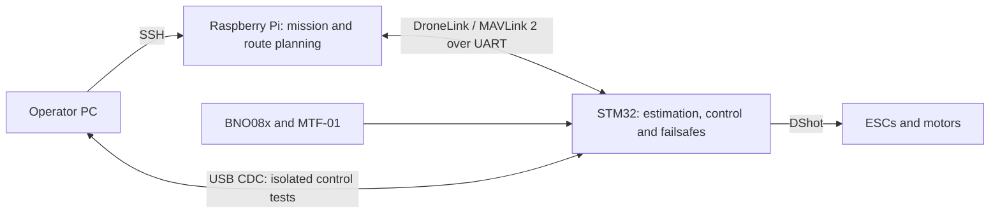

# Architecture / Structure

[Getting Started](README.md) / Architecture / Structure

## System responsibilities

The Raspberry Pi Zero W plans missions in Python. Its genetic algorithm chooses a closed route by minimizing total Euclidean distance in 3D. It sends mission objectives through DroneLink, the project's application protocol over MAVLink 2 and UART.

The STM32F411 runs FreeRTOS, sensor acquisition, state estimation, LQG control, motor mixing, DShot output and failsafes. The thesis baseline uses linear Kalman estimation; EKF changes are preserved separately as exploration. SSH provides operator access to the Pi; the Pi–STM32 link uses UART.



## Repository directories

| Directory | Responsibility and useful entry points |
| --- | --- |
| `stm32/` | CubeIDE firmware project. `App/Inc` and `App/Src` contain project code; `Core`, `Drivers`, `Middlewares` and `USB_DEVICE` provide platform support. `DroneController.ioc` holds CubeMX configuration; `.project`, `.cproject`, `.settings` and linker scripts support the build. |
| `stm32/protocol/` | DroneLink XML message definitions; generated MAVLink C headers live under `Middlewares`. |
| `stm32/tools/` | Desktop GUIs, gain generation and supporting scripts. Motor tests use `motores_gui.py` in the motor milestone; USB control uses `controle_gui.py`. |
| `stm32/tests/` | Host-side firmware tests. These do not establish flight qualification. |
| `stm32/reference/` | Generated reference code, including Simulink exports; not the complete modeling project. |
| `rpi/` | Deployed Pi software captured from `~/drone`, with documented local adaptations. `dronectl` is the launcher; `tools/pi/dronectl` contains communication, mission and route code. `tools/pi/tests`, `tools/pi/missoes` and `ensaios` hold tests, mission inputs and recordings. |
| `latex/` | Original Portuguese thesis. `main.tex` is the entry point, `partes` contains chapters, `images` contains figures and `references.bib` holds bibliography entries. |
| `docs/` | English project guidance, version provenance, validation, import review and future documentation topics. Historical firmware documentation remains in `stm32/docs`. |
| `matlab/` | Placeholder until the original MATLAB/Simulink files become available. |
| `provenance/` | Original Git bundle, Pi snapshots, experimental patch/new files, source manifests and verification records. `active-version.json` describes the selected snapshot. |

`stm32/tools/pi/` remains part of the original firmware trees. The top-level `rpi/` is the directly captured deployment. They are not interchangeable copies: deployed updates and repository adaptations are recorded in the provenance manifests.

## Choose a version

| Reference | Intended use |
| --- | --- |
| `main` | Continuing development and current documentation. It can change after the thesis. |
| `submission/2026-11-11` | Frozen organized thesis baseline, captured November 10 for the November 11 submission. |
| Tag `tcc-2026-11-11` | Fixed reference to that same submission commit. Keep this tag unchanged for thesis readers. |
| `milestone/*` | Named experimental stages, detailed below. |
| `exploration/ekf-2026-11-10` | Original local EKF/filter/control changes, including previously uncommitted files, paired with the captured `~/drone-better` software. Not thesis-baseline evidence. |
| `archive/*` | Original repository branches with original layout and history, without the new top-level organization. Use these for historical investigation. |

A branch is a movable named reference; a tag identifies a particular commit. The submission branch is intended to remain frozen, while `main` advances. Current documentation on `main` may include explanations added after the frozen submission snapshot.

## Experimental stages

| Branch | Original source | Scope |
| --- | --- | --- |
| `milestone/01-sensors` | `mtf-bno-test` | MTF-01 and BNO08x sensor tests. |
| `milestone/02-motors` | `motores` | Motor bench tests with the Python GUI. The older `motors` alternative remains in `archive/motors`. |
| `milestone/03-usb-control` | `controle` | Earlier isolated attitude/height tests through USB CDC and the desktop GUI, with horizontal control disabled. |
| `milestone/03-position-lqg` | `controle-lqg-posicao` | Later LQG position-control tests with the desktop interface. |
| `milestone/04-dronelink` | `comunicacao-pi-stm32` | Isolated protocol tests: real Pi and UART, simulated flight on the STM32, plus route reproducibility. The documented procedure enables `FLT_SIM=1`; this is not the firmware default. |
| `milestone/05-integrated-pi-hover` | `hover-lqg-pi` | Combined position control and Pi communication, identical to the submission snapshot. |

The two `03-*` branches distinguish control stages. The communication branch did not already include the later position-control branch: merge `5ff1699` combined them before integrated baseline `af6034e`.

**Historical milestones replace the `stm32/` tree, not the entire deployment from each historical date.** Other directories retain the submission capture. Use `stm32/tools/pi/` for companion sources from a historical firmware branch where available; do not assume its top-level `rpi/` was deployed at that earlier stage.

The experimental branch preserves a separate Pi deployment and its original launcher. Baseline test reports do not qualify experimental firmware. The thesis reports remaining horizontal-position and yaw limitations; the integrated milestone is not a claim of reliable autonomous free flight.

## Preserved original branches

The `archive/` prefix retains the original names: `main`, `mtf-bno-test`, `motores`, `motors`, `controle`, `controle-lqi`, `controle-lqg-posicao`, `lqg-ert`, `comunicacao-pi-stm32`, `hover-lqg-pi` and `hover-lqg-pi-better`. These record the original development paths; they are not all recommended operating configurations. The complete original bundle also retains additional original references.

In particular, `archive/hover-lqg-pi-better` records only its original committed tip. Its then-uncommitted improvements are preserved in `exploration/ekf-2026-11-10` and in the experimental provenance archives.

## Navigate locally

Save or commit current edits before switching versions:

```sh
git status
git branch --list
git switch milestone/03-usb-control
git switch milestone/04-dronelink
git switch submission/2026-11-11
git switch main
```

Switching branches changes local files; it does not flash the STM32 or deploy to the Pi. Source snapshots do not establish which firmware binary is currently flashed on the hardware.

See [version provenance](../versions.md) for source commit identities, [thesis alignment](../thesis-alignment.md) for the comparison with the written work, and [import review](../import-review.md) for outstanding requirements.
