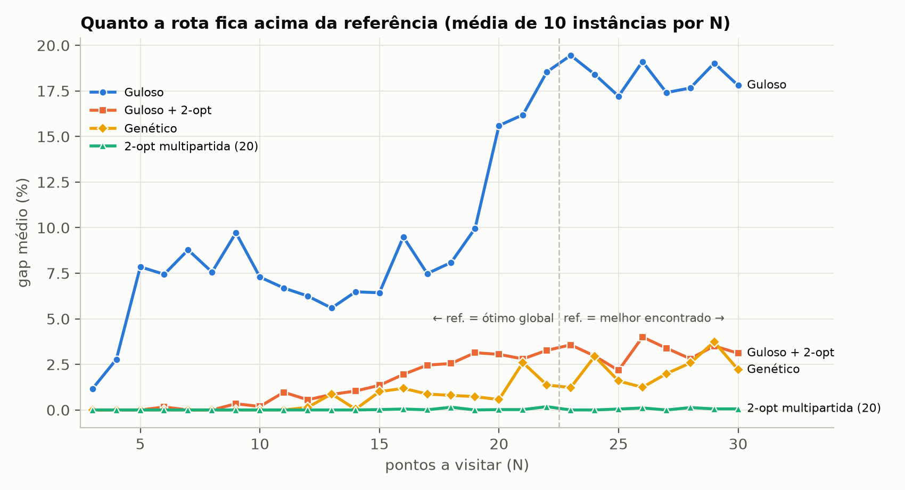
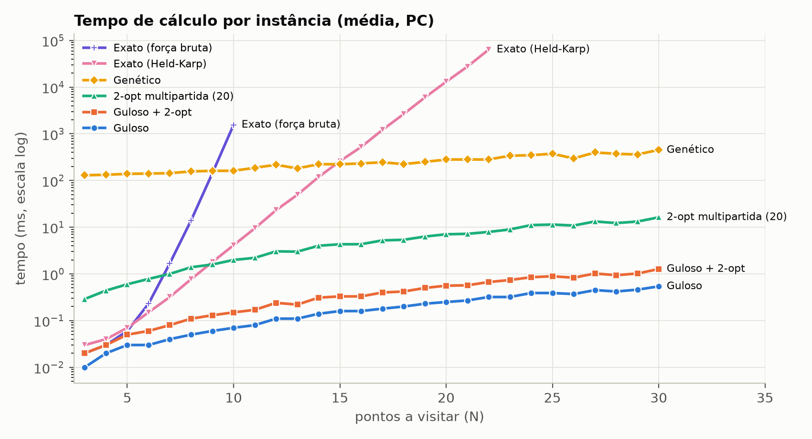
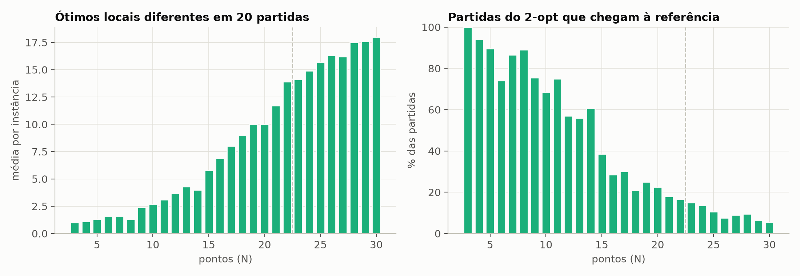
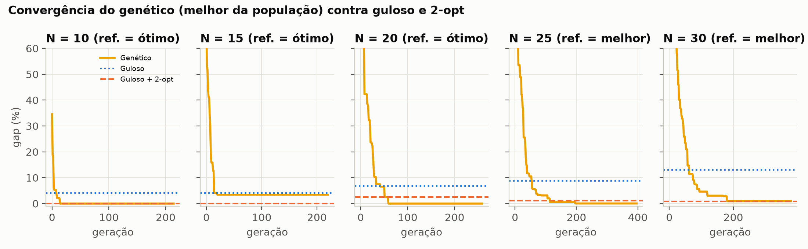

# Ordem de visita de pontos 3D (TSP): avaliação dos algoritmos

Avaliação dos algoritmos que a Raspberry Pi usa para decidir **em que ordem** o
drone visita N pontos (x, y, z) no comando `visitar` de `dronectl missao`. É o
problema do caixeiro-viajante (TSP) com depósito: o drone decola, fica estável
no ponto de partida, passa por todos os pontos e volta a ele.

- Código: [`tools/pi/dronectl/rotas.py`](../tools/pi/dronectl/rotas.py)
  (algoritmos), [`rotas_bench.py`](../tools/pi/dronectl/rotas_bench.py)
  (benchmark) e [`tools/pi/rotas_graficos.py`](../tools/pi/rotas_graficos.py)
  (gráficos). Python puro, sem numpy, para rodar igual no PC e na Pi Zero.
- Figuras para apresentação (rotas em 3D, distância, tempo e memória):
  [`docs/apresentacao_rotas/`](apresentacao_rotas/).
- Dados brutos: [`docs/resultados_rotas/pc/`](resultados_rotas/pc/) —
  `resultados.csv` (1680 execuções, com a ordem de cada rota), `limite_exato.md`,
  `otimos_locais.csv`, `convergencia.json`, `resumo.json`, `resumo.md`
  (tabelas completas por N) e `graficos/`.

## 1. O problema

- **Pontos:** N pontos (x, y, z) em cm, mais o ponto de partida P₀ = (0, 0, 50)
  — em cima da decolagem, a 50 cm.
- **Custo de uma rota:** comprimento do circuito P₀ → pontos na ordem → P₀,
  com distância euclidiana 3D: `d(a, b) = √((Δx)² + (Δy)² + (Δz)²)`.
- **Espaço de busca:** N! ordens (o sentido conta: as duas direções de um mesmo
  circuito são ordens diferentes de mesmo custo). Com 10 pontos são 3,6 milhões;
  com 20, 2,4 × 10¹⁸; com 30, 2,7 × 10³².
- **Dois algoritmos exatos** (dão o ótimo global com garantia): a **força
  bruta**, que testa as N! ordens, e o **Held-Karp**, que chega ao mesmo
  resultado por programação dinâmica, em N²·2ᴺ passos. As heurísticas (guloso,
  2-opt, genético) não garantem o ótimo, mas são rápidas.
- **Ótimo global:** a menor rota entre todas. **Ótimo local:** uma rota que
  nenhuma modificação pequena (definida pela vizinhança, aqui a do 2-opt)
  consegue melhorar — pode ser bem pior que o global.

## 2. Algoritmos e implementação

### 2.1 Aleatório (referência)

Uma permutação sorteada (Fisher-Yates). Não é uma proposta: mostra quanto se
perde **sem** algoritmo nenhum.

### 2.2 Guloso (vizinho mais próximo)

```text
atual ← P₀; restantes ← {1..N}
enquanto houver restantes:
    próximo ← o ponto de restantes mais perto de atual (empate: menor índice)
    adiciona próximo à rota; atual ← próximo
```

- Construtivo, O(N²), determinístico.
- Decide cada passo olhando só para o próximo ponto; no fim sobram pontos
  espalhados e a volta a P₀ fica longa. Não garante nem ótimo local.

### 2.3 Busca local 2-opt (ótimo local) e guloso + 2-opt

Vizinhança 2-opt: tirar duas arestas (a→b) e (c→e) da rota e religar como
(a→c) e (b→e) — o mesmo que **inverter o trecho b..c**. Se
`d(a,c) + d(b,e) < d(a,b) + d(c,e)`, a troca encurta a rota.

```text
repita:
    para cada par de arestas (i, j): se inverter o trecho i..j encurta, inverte
até uma passada inteira sem melhora      → a rota é um ÓTIMO LOCAL do 2-opt
```

- Cada passada é O(N²); o número de passadas depende da rota de partida.
- O resultado depende **de onde começa**: partindo do guloso
  (`guloso+2opt`), chega num ótimo local; partindo de outra rota, pode chegar
  em outro.
- Uma propriedade útil: um circuito 2-opt-ótimo no plano não se cruza.

### 2.4 2-opt multipartida (vários ótimos locais)

Roda o 2-opt a partir de **20 rotas aleatórias** (sementes fixas) e fica com o
melhor dos 20 ótimos locais. É a forma mais simples de escapar de um ótimo local
ruim: em vez de melhorar uma rota, explora várias "bacias". Também serve para
**medir** a paisagem: quantos ótimos locais diferentes existem e quantas
partidas chegam ao ótimo global (seção 4.3).

### 2.5 Algoritmo genético (busca global estocástica)

| Elemento | Escolha |
|---|---|
| Indivíduo | uma permutação dos N pontos (P₀ fica fixo no início e no fim) |
| Aptidão | comprimento do circuito (menor é melhor) |
| População inicial | 120 permutações aleatórias |
| Seleção | torneio de 3: sorteia 3 indivíduos, vence o mais curto |
| Cruzamento | **OX (order crossover)**, taxa 0,9: copia um trecho [a, b] do pai 1 no mesmo lugar e completa com os pontos que faltam na ordem em que aparecem no pai 2 (o filho é sempre uma permutação válida) |
| Mutação | **inversão** de um trecho sorteado, taxa 0,3 (a mesma operação do 2-opt, mas aleatória) |
| Elitismo | os 2 melhores passam direto para a próxima geração |
| Parada | 800 gerações ou 200 gerações seguidas sem melhorar o melhor |
| Semente | 2026 (mesma rota em qualquer máquina) |

```text
população ← 120 permutações aleatórias
repita por geração:
    nova ← os 2 melhores
    enquanto nova < 120:
        p1, p2 ← torneio(3), torneio(3)
        filho ← OX(p1, p2) com prob. 0,9, senão cópia de p1
        com prob. 0,3: inverte um trecho sorteado do filho
        nova ← nova + filho
    população ← nova
até 800 gerações ou 200 sem melhora
```

- Custo: O(G · P · N), G = gerações (272 em média nos testes; mínimo 200,
  máximo 665), P = 120.
- Não usa busca local (é um GA "puro"): a melhora vem só de seleção,
  cruzamento e mutação.

### 2.6 Exato por força bruta (ótimo global, pela definição)

```text
melhor ← ∞
para cada uma das N! ordens dos pontos (ordem lexicográfica):
    c ← d(P₀, 1º) + Σ d(iº, (i+1)º) + d(Nº, P₀)
    se c < melhor: guarda a ordem
```

- É o TSP "virado código": testa **todas** as ordens, sem atalho nenhum (nem a
  simetria de percorrer o circuito ao contrário, que cortaria só pela metade).
- **O(N · N!) de tempo e O(N) de memória**: a memória não é problema, o tempo
  sim — **multiplica por N a cada ponto a mais** (×11 de 10 para 11 pontos).
- Usa `itertools.permutations` (em C) e soma as distâncias de uma matriz
  pré-calculada: é a força bruta mais rápida possível em Python puro.

### 2.7 Exato: Held-Karp (ótimo global, por programação dinâmica)

Programação dinâmica sobre subconjuntos. `C(S, j)` = menor caminho que sai de
P₀, visita exatamente os pontos do subconjunto S e termina em j ∈ S:

```text
C({j}, j) = d(P₀, j)
C(S, j)   = min_{k ∈ S, k ≠ j} [ C(S \ {j}, k) + d(k, j) ]
ótimo     = min_j [ C({1..N}, j) + d(j, P₀) ]
```

- N · 2ᴺ estados com N escolhas cada: **O(N² 2ᴺ) de tempo e O(N 2ᴺ) de
  memória**. Implementado com `array('d')` plano (8 bytes por estado) e o
  predecessor em `array('b')` para reconstruir a rota.
- Garante o ótimo global. O tempo **multiplica por ~2,2 a cada ponto a mais**.
- **Por que é tão mais rápido que a força bruta:** duas rotas parciais que
  visitaram o mesmo conjunto de pontos e terminam no mesmo ponto têm o mesmo
  futuro; basta guardar a mais curta. Em vez de N! rotas, o algoritmo trabalha
  com N · 2ᴺ "estados" (conjunto visitado, ponto final). Com 20 pontos:
  20! ≈ 2,4 × 10¹⁸ ordens contra 20² · 2²⁰ ≈ 4,2 × 10⁸ operações. O preço é a
  **memória**: a tabela dos N · 2ᴺ estados.
- Conferido contra a força bruta: igual em todas as instâncias em que as duas
  rodaram (testes com N ≤ 9 e benchmark com N ≤ 10, que para se divergirem).

### 2.8 Reprodutibilidade

Todos os sorteios usam só `random.random()` — a única função do módulo
`random` que o Python garante igual entre versões (`shuffle`, `sample` e
`randint` podem mudar) — e as distâncias usam `math.sqrt` (arredondamento
IEEE 754, igual em qualquer máquina). Com a mesma semente, **PC e Raspberry Pi
produzem as mesmas rotas**. O benchmark grava uma assinatura SHA-256 dos
pontos e das rotas: ela tem de ser igual nas duas máquinas.

## 3. Metodologia

### 3.1 Critério de viabilidade dos exatos

Um exato sai do comparativo quando **uma instância leva mais de ~1 min** no PC
ou **não cabe na memória**, e não volta mais para N maiores. Os limites foram
medidos, não estimados (`dronectl rotas-limite`,
[`limite_exato.md`](resultados_rotas/pc/limite_exato.md)): cada algoritmo rodou
numa instância de cada N, **cada N num processo separado**, medindo o tempo e o
**pico real de RAM do processo**.

**Força bruta** (memória constante, ~22 MB do próprio Python):

| N | ordens testadas | tempo | | N | tempo previsto (c · N!) |
|---|---|---|---|---|---|
| 5 | 120 | 0,1 ms | | 12 | ≈ 3 min |
| 8 | 40 320 | 14 ms | | 13 | ≈ 43 min |
| 9 | 362 880 | 0,15 s | | 15 | ≈ 6 dias |
| **10** | **3 628 800** | **1,5 s** | | 17 | ≈ 4,7 anos |
| 11 | 39 916 800 | **18 s** | | 20 | ≈ 32 mil anos |
| | | | | 25 | ≈ 2 × 10¹¹ anos (15× a idade do universo) |

**Held-Karp:**

| N | tempo medido | pico de RAM | | N | tempo previsto (c · N² · 2ᴺ) | memória necessária |
|---|---|---|---|---|---|---|
| 15 | 0,24 s | 22 MB | | 24 | ≈ 5 min | 3,6 GB — praticamente toda a RAM livre |
| 18 | 2,6 s | 54 MB | | 25 | ≈ 10 min | 7,5 GB — **não cabe na RAM total** |
| 20 | 12,5 s | 194 MB | | 27 | ≈ 48 min | 32,6 GB |
| 21 | 26 s | 391 MB | | 30 | ≈ 8 h | 290 GB |
| **22** | **59–64 s** | **806 MB** | | | | |
| 23 | **125–131 s** | **1,7 GB** | | | | |

PC: Intel i5-9300HF, 7,3 GB de RAM (2 a 3,7 GB livres, conforme o momento),
Python 3.14.7. Os tempos de 22 e 23 pontos são de duas medições com cargas
diferentes no PC. Previsões ajustadas nos maiores N medidos; a do Held-Karp foi
conferida antes rodando 20–22 pontos (erro de 2 a 10 %).

**Conclusão do limite — o comparativo tem três fases:**

| Faixa | Quem compara | Por quê |
|---|---|---|
| **3 a 10 pontos** | aleatório, guloso, genético (e 2-opt), **força bruta e Held-Karp** | os dois exatos rodam e dão o mesmo ótimo — conferido em todas as 80 instâncias |
| **11 a 22 pontos** | aleatório, guloso, genético (e 2-opt), **Held-Karp** | a força bruta passa de 17 s com 11 pontos e de 3 min com 12 (×N a cada ponto) |
| **23 a 30 pontos** | **só aleatório, guloso e genético** (e 2-opt) | o Held-Karp passa de 2 min e 1,7 GB com 23; com 25 precisa de 7,5 GB e não cabe na RAM do PC: **impossível neste computador** |

- Na **Raspberry Pi Zero** (512 MB para tudo), a memória do Held-Karp passa da
  metade da RAM a partir de **21 pontos**.
- Com 20 pontos, a força bruta levaria ~32 mil anos e o Held-Karp leva 12 s:
  **o mesmo problema, o mesmo resultado exato, e uma diferença de ~10¹¹ vezes no
  tempo** — é o que a programação dinâmica ganha. Mas os dois continuam
  exponenciais, e o Held-Karp troca o tempo por memória.

O inviável são **estes métodos exatos** (força bruta e Held-Karp). O TSP
sempre tem ótimo, e solvers de *branch-and-cut* como o Concorde resolvem 30
pontos rapidamente, mas dependem de um solver de programação linear e não têm
tempo garantido — o que não cabe no objetivo de rodar na Pi Zero.

### 3.2 Benchmark

| Item | Valor |
|---|---|
| N (pontos além de P₀) | 3 a 30 |
| Instâncias por N | 10 (sementes 1 a 10) — **280 instâncias, 1680 execuções** |
| Pontos | x, y inteiros num quadrado de 6 m × 6 m centrado na decolagem; z de 30 a 150 cm (limites do STM32) |
| Algoritmos | aleatório, guloso, guloso+2opt, 2-opt multipartida (20), genético, força bruta, Held-Karp |
| Exatos | força bruta até **N = 10**; Held-Karp até **N = 22** (critério da seção 3.1) |
| Referência | ótimo global (N ≤ 22); acima, o **melhor encontrado** entre os algoritmos |
| Métricas | distância do circuito → gap (% acima da referência), acertos (instâncias em que achou a referência); tempo de cálculo |
| Máquina | Intel i5-9300HF, Python 3.14.7 — 21 min no total (15 min só do Held-Karp com 20–22 pontos; 16 s da força bruta com 10 pontos) |
| Assinatura | `af4482d38e122be77517d9b9b097ebbdda6414b8f72f5601382e9dcb978532f0` |

Rodar: `cd tools/pi && python3 -m dronectl rotas-limite --tempo-max-s 70 --saida ../../docs/resultados_rotas/pc`,
`python3 -m dronectl rotas-bench --exato-max-s 70 --exato-max-mb 1500 --saida ../../docs/resultados_rotas/pc`
e `python3 rotas_graficos.py ../../docs/resultados_rotas/pc`.

Limitação: acima de N = 22 a referência é o melhor dos próprios algoritmos —
quase sempre o 2-opt multipartida —, então os gaps dessa faixa são relativos e
o do 2-opt multipartida tende a zero por construção.

## 4. Resultados

### 4.1 Qualidade da rota (distância)



Gap médio (pior instância) e acertos da referência, por faixa de N:

| N | aleatório | guloso | guloso+2opt | 2-opt multi | genético |
|---|---|---|---|---|---|
| 3–8 (vs. ótimo) | 37,7 % (122,6) · 6/60 | 5,9 % (28,6) · 10/60 | 0,0 % (1,6) · 59/60 | 0,0 % (0,0) · 60/60 | 0,0 % (0,0) · 60/60 |
| 9–14 (vs. ótimo) | 99,4 % (177,9) · 0/60 | 7,0 % (26,4) · 2/60 | 0,7 % (5,5) · 36/60 | 0,0 % (0,0) · 59/60 | 0,2 % (5,8) · 53/60 |
| 15–19 (vs. ótimo) | 139,3 % (198,7) · 0/50 | 8,3 % (29,1) · 0/50 | 2,3 % (11,6) · 20/50 | 0,0 % (1,4) · 44/50 | 0,9 % (7,8) · 25/50 |
| 20–22 (vs. ótimo) | 153,0 % (195,7) · 0/30 | 16,8 % (31,7) · 0/30 | 3,0 % (13,0) · 8/30 | 0,1 % (1,3) · 26/30 | 1,5 % (9,6) · 12/30 |
| 23–26 (vs. melhor) | 162,0 % (206,8) | 18,5 % (36,9) | 3,2 % (10,6) | 0,0 % (0,6) | 1,8 % (7,5) |
| 27–30 (vs. melhor) | 202,7 % (264,7) | 18,0 % (35,2) | 3,2 % (10,4) | 0,1 % (1,4) | 2,6 % (7,7) |

Até N = 22, onde o ótimo é conhecido (200 instâncias), cada algoritmo achou o
ótimo global em: aleatório 6, guloso 12, guloso+2opt 123, **genético 150**,
**2-opt multipartida 189**.

Comparação direta nas 280 instâncias:

| | melhor | pior | empate |
|---|---|---|---|
| 2-opt multipartida × genético | 106 | 8 | 166 |
| genético × guloso+2opt | 121 | 44 | 115 |
| guloso+2opt × guloso | 263 | 0 | 17 |

### 4.2 Tempo de cálculo



Média por instância no benchmark (10 instâncias por N):

| N | guloso | guloso+2opt | 2-opt multi | genético | força bruta | Held-Karp |
|---|---|---|---|---|---|---|
| 5 | 0,03 ms | 0,05 ms | 0,6 ms | 139 ms | 0,06 ms | 0,07 ms |
| 10 | 0,07 ms | 0,15 ms | 2,0 ms | 162 ms | **1,56 s** | 4,1 ms |
| 15 | 0,16 ms | 0,33 ms | 4,3 ms | 223 ms | ≈ 6 dias (previsto) | 260 ms |
| 20 | 0,25 ms | 0,56 ms | 7,1 ms | 281 ms | ≈ 32 mil anos (previsto) | 13,0 s |
| 22 | 0,32 ms | 0,67 ms | 7,9 ms | 282 ms | ≈ 15 milhões de anos | **63,7 s** |
| 25 | 0,39 ms | 0,89 ms | 11,4 ms | 376 ms | ≈ 2 × 10¹¹ anos | não cabe na RAM (7,5 GB) |
| 30 | 0,54 ms | 1,27 ms | 16,3 ms | 454 ms | ≈ 3,5 × 10¹⁸ anos | ≈ 8 h e 290 GB (previsto) |

- A **força bruta** multiplica o tempo por N a cada ponto a mais: 1,6 s com 10
  pontos, 17 s com 11, 3 min com 12 e 43 min com 13.
- O **Held-Karp** cresce exponencialmente (reta na escala log): ×2,2 por ponto
  em tempo e ×2 em memória — bem mais devagar que a força bruta, mas ainda
  exponencial.
- Os outros crescem de forma polinomial: o genético vai de 0,14 s (5 pontos) a
  0,45 s (30 pontos). Os tempos variam ~10 % entre rodadas (carga do PC); as
  rotas e distâncias não mudam.

### 4.3 Ótimos locais × ótimo global



Com 20 partidas aleatórias do 2-opt por instância:

| N | ótimos locais diferentes (média) | partidas que chegaram à referência | pior ótimo local |
|---|---|---|---|
| 5 | 1,3 | 89,5 % | 1,7 % acima |
| 10 | 2,7 | 68,5 % | 8,4 % acima |
| 15 | 5,8 | 38,5 % | 23,3 % acima |
| 20 | 10,0 | 22,5 % | 15,5 % acima |
| 22 | 13,9 | 16,5 % | 23,0 % acima |
| 30 | 18,0 | 5,5 % | 17,3 % acima |

- Com poucos pontos, quase todo ótimo local já é o global.
- Com mais pontos, a paisagem fica cheia de ótimos locais: com 30 pontos, as 20
  partidas caem em ~18 ótimos diferentes e só 1 em cada 18 chega à melhor rota.
  Uma busca local **de uma partida só** (como o guloso+2opt) fica presa em um
  deles — por isso ela erra 2–3 % em média e até 13 % no pior caso.
- Repetir a busca local de vários pontos de partida resolve: com 20 partidas,
  pelo menos uma caiu na bacia do ótimo global em 189 de 200 instâncias até
  N = 22.

### 4.4 Convergência do genético



O genético começa muito longe (população aleatória, 35–150 % acima) e melhora
rápido nas primeiras ~50–150 gerações, passando o guloso e, na maioria dos
casos, o guloso+2opt. Depois estabiliza: em N = 15 (instância 1) parou 3,4 %
acima do ótimo — num ótimo local da própria população, que a mutação sozinha
não tira. Sem busca local, ele não refina a rota.

## 5. Validação no STM32 (drone simulado, `FLT_SIM = 1`)

As rotas foram executadas pelo STM32 real (máquina de voo, LQG do TCC e drone
simulado), com giro + "frente" (subindo ou descendo junto) para cada ponto e
espera de "estável" em cada trecho. O objetivo é confirmar que a rota calculada
na Pi é executada como planejada pelo STM32.

**2D (N = 6, z fixo):** guloso 1933 cm; exato 1637 cm (−15,3 %); as duas rotas
terminaram a menos de 1 cm da partida.

**3D (N = 6, semente 10, alturas de 64 a 145 cm):** pontos (cm) (-177, 188, 129),
(-104, -150, 145), (43, -43, 99), (62, -71, 64), (92, -204, 93), (298, -274, 134).

| Algoritmo | Ordem | Circuito 3D | Trechos executados | Maior erro num ponto |
|---|---|---|---|---|
| guloso | 3 4 5 2 1 6 | 1898 cm | 14 | 3,0 cm |
| exato | 1 2 5 6 4 3 | **1493 cm (−21,3 %)** | 14 | 3,1 cm |

(O genético e o 2-opt multipartida acharam a mesma rota do exato, no sentido
inverso — mesmo comprimento.) O drone chegou em cada ponto (x, y, z) a no
máximo 3,1 cm, dentro da tolerância de 5 cm que o STM32 usa para declarar
"estável".

## 6. Conclusão

1. **O TSP exato fica inviável cedo, mesmo com o melhor algoritmo exato
   clássico.** A **força bruta** (N! ordens) só serve até **10 pontos** (1,5 s;
   com 11 já são 17 s e com 20 seriam ~32 mil anos). O **Held-Karp**, que chega
   ao mesmo ótimo por programação dinâmica, vai até **22 pontos** (~1 min por
   instância); com 23 passa de 2 min e 1,7 GB e sai do comparativo, e com **25
   pontos é impossível neste PC** (7,5 GB de RAM). Na Raspberry Pi Zero o limite
   é ainda menor (memória passa da metade da RAM com 21). Para a missão, o
   `visitar` aceita no máximo 9 pontos na força bruta e 16 no exato.
2. **O algoritmo genético é viável em toda a faixa**: 0,14 s com 5 pontos e
   0,45 s com 30, memória desprezível, rotas em média de 0 a 3,7 % acima da
   referência, e o ótimo global em 150 de 200 instâncias até 22 pontos.
3. Entre os não-exatos, o **2-opt multipartida** foi ainda melhor nos dados:
   ótimo em 189 de 200 instâncias, melhor que o genético em 106 das 280 e pior
   em só 8, em ~1/30 do tempo (14 ms com 30 pontos). O genético, sem busca local,
   para em 1–3 % do ótimo; um **algoritmo memético** (GA + 2-opt nos filhos)
   seria o próximo passo natural.
4. O **guloso** é instantâneo mas perde 6–18 % de distância; o
   **guloso+2opt** recupera quase tudo em ~1 ms; a ordem **aleatória** chega a
   3× o ótimo.

Recomendação para a missão: **exato (Held-Karp) até 12–16 pontos; acima disso, uma
meta-heurística** (2-opt multipartida ou genético).

## 7. Pendente: na Raspberry Pi

1. `python3 -m dronectl rotas-bench --exato-max-mb 150 --saida resultados_rotas/pi`
   — a assinatura tem de ser **igual à do PC** (`af4482d3…`), provando que o
   algoritmo da Pi é o do benchmark; e os tempos de cálculo da Pi Zero (o que
   importa em voo) entram na tabela 4.2.
2. `visitar` com cada algoritmo, comandando o STM32 pela UART.
